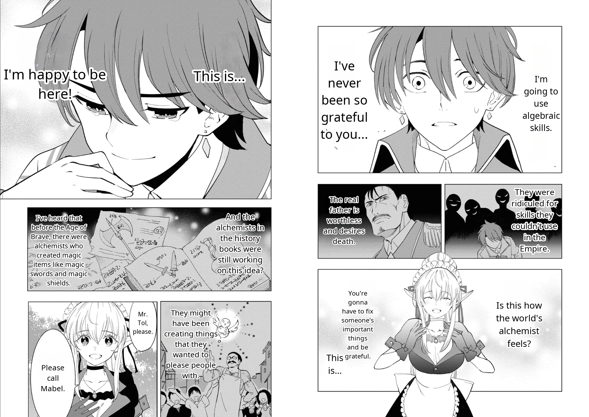

# manga-translation

Offline translation of manga, manhwa, manhua and comic pages (Japanese, English, Korean or Chinese source text): text detection, OCR, machine translation, inpainting and typesetting, all running locally on ONNX Runtime.

## Example

| Input | Output (`--language en`) |
|---|---|
|  |  |

## Pipeline

Each page goes through these steps in order:

1. **Image loading**: reads a PNG/JPG, converts it to RGB and optionally downscales it.
2. **Text detection**: finds text regions and a text mask with [comic-text-detector](https://github.com/dmMaze/comic-text-detector).
3. **Text recognition**: reads the text of each region: Japanese with [manga-ocr](https://github.com/kha-white/manga-ocr), English, Korean and Chinese line by line with [PaddleOCR](https://github.com/PaddlePaddle/PaddleOCR) (PP-OCRv5; horizontal text only).
4. **Text translation**: translates each region with [NLLB-200 distilled 600M](https://huggingface.co/facebook/nllb-200-distilled-600M).
5. **Text erasing**: removes the original text with [LaMa](https://github.com/advimman/lama) inpainting.
6. **Text rendering**: draws the translation inside the original region (or speech bubble) using Noto Sans fonts.
7. **Page saving**: writes the result to the output directory.

## Requirements

- Python >= 3.13
- [uv](https://docs.astral.sh/uv/)
- About 4.5 GB of disk space for the models

## Installation

```bash
uv sync
```

### Models

The models and fonts are not part of the repository (`models/` is git-ignored). Download them with:

```bash
uv run python main.py download-models [--config FILE]
```

Files are saved to the paths from `config.yaml` (or `--config`); files that already exist are skipped, so an interrupted download can be resumed by running the command again. The application expects this layout:

```
models/
├── comictextdetector.pt.onnx
├── manga-ocr/
│   ├── encoder_model.onnx
│   ├── decoder_model_merged.onnx
│   └── vocab.txt
├── paddleocr/
│   ├── en/
│   │   ├── model.onnx
│   │   └── dict.txt
│   ├── ko/
│   │   └── ...
│   └── zh/
│       └── ...
├── nllb-200-distilled-600M/
│   ├── encoder_model.onnx
│   ├── decoder_model.onnx
│   └── tokenizer.json
└── lama/
    └── lama_fp32.onnx
fonts/
├── NotoSans-Regular.ttf
└── NotoSansCJKjp-Regular.otf
```

To download the files manually instead, use these sources:

| File | Source |
|---|---|
| `comictextdetector.pt.onnx` | [manga-image-translator release `beta-0.3`](https://github.com/zyddnys/manga-image-translator/releases/tag/beta-0.3) |
| `manga-ocr/*` | [dnouv/manga-ocr](https://huggingface.co/dnouv/manga-ocr) (ONNX files from `onnx/`) |
| `paddleocr/{en,ko,zh}/*` | [monkt/paddleocr-onnx](https://huggingface.co/monkt/paddleocr-onnx): `rec.onnx` and `dict.txt` from `languages/english`, `languages/korean` and `languages/chinese`, saved as `model.onnx` and `dict.txt` |
| `nllb-200-distilled-600M/*` | [Xenova/nllb-200-distilled-600M](https://huggingface.co/Xenova/nllb-200-distilled-600M) (fp32 `encoder_model.onnx` and `decoder_model.onnx` from `onnx/`, not the `merged` or `with_past` variants) |
| `lama/lama_fp32.onnx` | [Carve/LaMa-ONNX](https://huggingface.co/Carve/LaMa-ONNX) |
| `fonts/NotoSans-Regular.ttf` | [Noto Sans](https://github.com/notofonts/notofonts.github.io/tree/main/fonts/NotoSans) (Latin, Cyrillic and Vietnamese) |
| `fonts/NotoSansCJKjp-Regular.otf` | [Noto Sans CJK](https://github.com/notofonts/noto-cjk) (Chinese, Korean and Japanese) |

## Usage

```bash
uv run python main.py translate <image|directory> [--config FILE] [--source-language CODE] [--language CODE] [--max-size N] [--output DIR]
```

- `<image|directory>`: a PNG/JPG file, or a directory whose PNG/JPG files are translated in name order.
- `--config`: YAML settings file, `./config.yaml` by default when it exists (see [Configuration](#configuration)).
- `--source-language`: language of the text on the pages, `ja` by default. Supported: `ja`, `en`, `ko`, `zh`.
- `--language`: target language, `en` by default. Supported: `en`, `pl`, `de`, `fr`, `es`, `it`, `pt`, `ru`, `uk`, `zh`, `ko`, `ja`, `id`, `vi`, `tr`.
- `--max-size`: longest image side in pixels, `4096` by default; `0` disables resizing.
- `--output`: directory for translated pages, `output` by default; files keep their source names.

Examples:

```bash
uv run python main.py translate examples/input.png --language en
uv run python main.py translate manhwa/ --source-language ko --language pl
```

## Configuration

All settings live in [`config.yaml`](config.yaml): the source and target languages at the top level, then one section per pipeline step (model paths, detection thresholds, font sizes, output directory). Settings left out of the file keep their defaults, and command-line options override the file. Unknown settings and values of the wrong type are rejected with an error naming the setting.

## Tests

```bash
uv run python -m unittest discover tests
```

The tests do not need the model weights.

## Licenses

The models and fonts are distributed under their authors' licenses. Check the source links above before using them. In particular, NLLB-200 is licensed under **CC-BY-NC 4.0**, which allows only non-commercial use.
